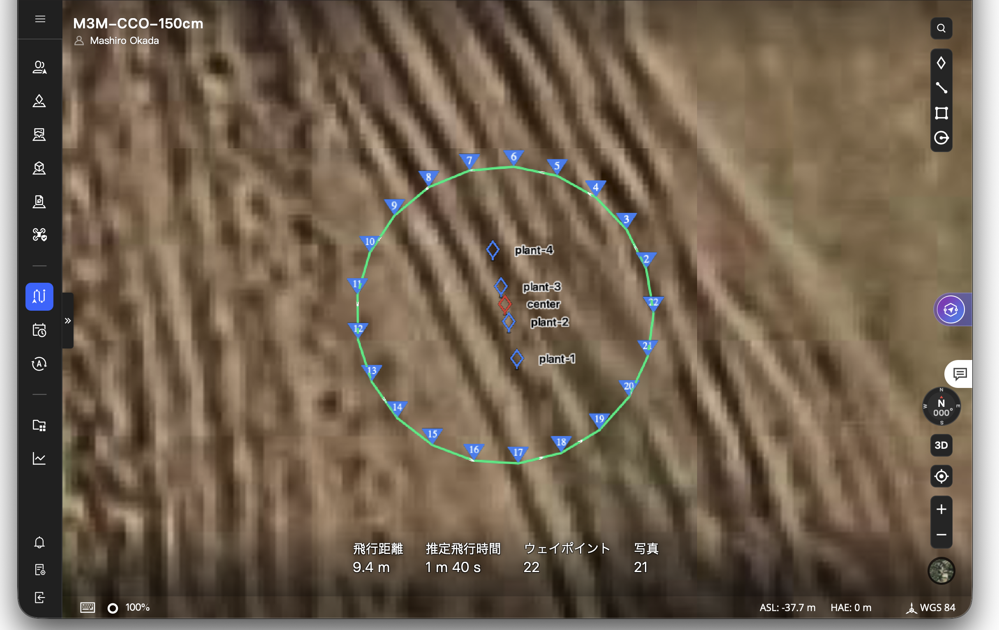

# ブロッコリー4個体のCCO撮影ミッション

**DJI Mavic 3 Multispectralによる，ブロッコリー4個体のCCO多視点撮影ミッションのサンプルです。**

自然言語のプロンプト，対象4個体と中心POIのGIS，Pythonコード，生成済みKMZと推定撮影範囲を収録しています。利用したDSMの実ファイルは公開対象外です。経路の線データや撮影範囲の統合ポリゴンも含めていません。

## まず見るファイル

- **ミッションを使う：** [M3M-CCO-150cm.kmz](results/M3M-CCO-150cm.kmz)
- **入力位置を見る：** [4個体のGeoJSON](data/plant-locations.geojson)／[中心POIのGeoJSON](data/observation-center.geojson)
- **撮影配置・範囲を見る：** [21撮影地点](results/gis/photo-positions.geojson)／[RGB・MSの推定撮影範囲](results/gis/estimated-footprints-rgb-ms.geojson)
- **要求の記述を見る：** [日本語のプロンプト例](prompt.ja.md)
- **再生成する：** [実行スクリプト](src/generate_mission.py)

## FlightHub 2での表示例



ブロッコリー4個体と中心POIを囲む飛行計画の表示例です。画面上では，飛行距離9.4 m，推定飛行時間1分40秒，22ウェイポイント，21回の撮影として表示されています。距離・時間・撮影回数は計画上の表示であり，実飛行の測定値や実際の取得画像数を示すものではありません。

## FlightHub 2のプロジェクト参加情報

| 項目 | 設定 |
| --- | --- |
| 参加コード | `Aeblbe` |
| 有効期限 | `2032-12-31 23:59:59` |

有効期限は管理画面に表示された日時です。参加には，コードに加えてプロジェクトIDまたは参加リンクが必要です。プロジェクトID・参加リンクはこのREADMEには未記載です。

参加方法は[DJI FlightHub 2公式マニュアル](https://fh.dji.com/user-manual/en/organization-management/create-a-project.html)を参照してください。

## ディレクトリ構成

```text
broccoli-cco-mission-example/
├── README.md
├── data-notes.md               # データ・高さ基準の説明
├── flighthub2-mission-preview.png # FlightHub 2での表示例
├── prompt.ja.md                # 日本語のプロンプト例
├── requirements.txt
├── test_example.py             # データ・ミッションの整合性テスト
├── data/                      # 4個体と中心POI：GeoJSON
├── src/
│   ├── generate_mission.py     # 実行入口
│   ├── cco_core.py             # カメラ幾何・地形参照・WPML出力
│   └── waypoint_builder.py     # 撮影地点・動作の組み立て
├── results/
│   ├── M3M-CCO-150cm.kmz      # 生成済みミッション
│   └── gis/                   # 撮影地点・推定撮影範囲
└── validation/                # 検証結果・チェックサム
```

## 観測条件

| 項目 | 設定 |
| --- | --- |
| 対象 | 直線上のブロッコリー4個体を一つの観測群として扱う |
| POI | 列の中央2個体の中点 |
| 対象機体 | DJI Mavic 3 Multispectral |
| 円周の半径 | 1.5 m |
| 高度設定 | 撮影地点直下のDSM高さ ＋ 1.5 m |
| ジンバルピッチ | −45° |
| 機首方位 | 水平方向にPOIへ向ける |
| 撮影配置 | 東側から反時計回りに21地点，約17.14°間隔 |
| 移動速度 | 1.0 m/s |
| 撮影 | 各地点で停止，RGB・MSを撮影 |
| ウェイポイント数 | 21撮影地点 ＋ 1閉路点 |

ミッション名は`M3M-CCO-150cm`，ウェイポイント名は`001`～`022`です。`022`は撮影を行わない閉路点です。

撮影前のホバリングは約1.65秒です。最初の地点ではピント合わせと追加の0.3秒待機を保持しています。

## 再生成

Python 3.12で動作確認しています。リポジトリのルートで実行します。

```bash
python -m venv .venv
source .venv/bin/activate
python -m pip install -r requirements.txt
python src/generate_mission.py --dem /path/to/dsm.tif --geoid-grid /path/to/us_nga_egm96_15.tif --output-dir generated
```

DSMを使った高度計算はそのまま残しています。`--dem`でローカルに保存したDSMのパスを指定してください。元と同じ計画の再生成には，同じDSMが必要です。DSMの高さ基準はWGS84楕円体高です。

高さ変換に必要なEGM96グリッドも外部ファイルとして指定します。PROJに既に導入済みなら`--geoid-grid`は省略できます。必要なデータと依存パッケージがローカルに揃っていれば，オフラインで実行できます。

```text
generated/
├── M3M-CCO-150cm.kmz
├── inputs/       # 入力2層のGeoJSON
└── gis/          # 21撮影地点・42撮影範囲のGeoJSON
```

既存の結果を上書きしないため，`--output-dir`には未作成のディレクトリを指定してください。`generated/`はGitの管理対象外です。

## GISの内容

ベクタデータの座標はすべて **WGS84の経度・緯度** です。GeoJSONは次の4ファイルです。

| ファイル | 地物 |
| --- | --- |
| `data/plant-locations.geojson` | 個体位置：4点 |
| `data/observation-center.geojson` | 中心POI：1点 |
| `results/gis/photo-positions.geojson` | 撮影地点：21点 |
| `results/gis/estimated-footprints-rgb-ms.geojson` | 撮影範囲：42ポリゴン（RGB・MS各21） |

`waypoint_name`は`001`～`021`です。画像照合用の`file_suffix`（`G1-001`～`G1-021`）で撮影地点と撮影範囲を対応づけます。`sensor`でRGBとMSを区別します。撮影を行わない閉路点はKMZ内にのみ保持しています。

[データの説明](data-notes.md)も参照してください。

## 検証

```bash
python -m unittest test_example -v
```

既存KMZとの撮影地点・高度・機首方位・動作の一致，GeoJSONの座標と地物数，4個体の入力点を含む推定範囲，80%以上の隣接範囲の重複を確認しています。[検証結果](validation/report.json)を参照してください。

通常は公開ファイルの整合性を検証し，非公開DSMを必要とする再生成テストだけをスキップします。再生成テストも実行する場合は，`BROCCOLI_DSM`と`BROCCOLI_EGM96_GRID`にローカルファイルのパスを設定してください。

## 取得画像の共有

取得画像は本リポジトリには含めていません。データの共有に関しては個別に対応いたします。

## 適用範囲と注意

- 同梱KMZは元の複数群ミッションから対象群だけを抽出した計画です。ミッション名とウェイポイント名以外の地点設定・撮影動作は保持しています。
- これは固定条件の再現用サンプルです。他の場所・高度・機体への一般的な最適化ツールではありません。
- 「1.5 m」は入力DSMを基準とする設定値であり，植物上端からの距離や実測高度を保証しません。
- 推定撮影範囲は，POIのDSM標高を持つ水平面への投影です。DSMの起伏との視線交差計算ではありません。
- 入力点が範囲内でも，植物全体の収まりや遮蔽の有無は保証しません。
- この単独版の実機読み込み・実飛行と，取得画像との照合は未実施です。再飛行に使う前に現地条件と機体設定を確認してください。

この一式にはプロジェクトのライセンスファイルはまだ含めていません。
